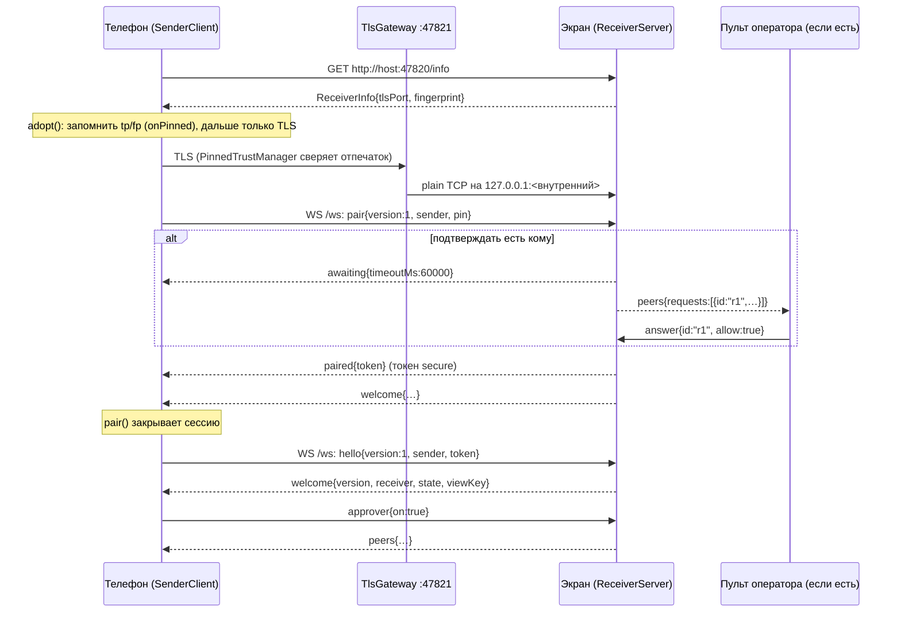
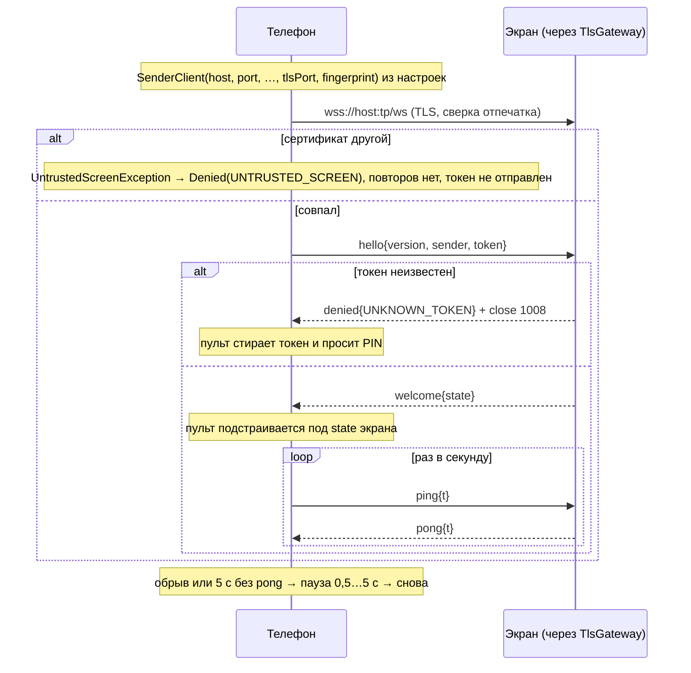
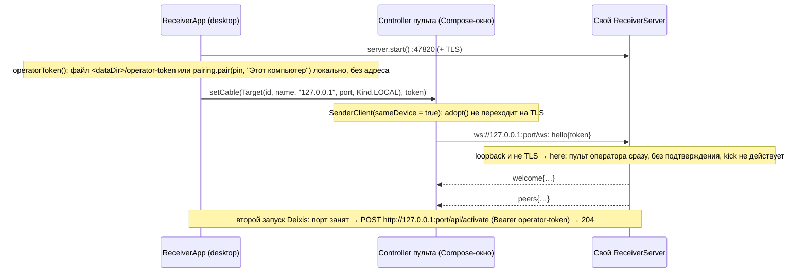

# Протокол Deixis: как устройства говорят друг с другом

Справочник для того, кто пишет совместимый пульт, экран или проверку. Всё ниже сверено с кодом
`core/src/main/kotlin/app/deixis/core/` (имена файлов и функций указаны без номеров строк). Где поведение
не удалось подтвердить по коду, стоит пометка «не проверено».

Роли:

- **Экран (приёмник)** — `ReceiverCore` + `ReceiverServer` (`Receiver.kt`). Сервер работает на экране: Deixis TV,
  «Стать экраном» на телефоне, Deixis для компьютера.
- **Пульт (источник)** — `SenderClient` (`Sender.kt`): приложение на телефоне, окно пульта на компьютере,
  пересылка показа компьютера на экраны в сети (`ScreenRelay`, `Relay.kt`).
- **Веб-пульт** — страница `core/src/main/resources/web/remote.html`, которую отдаёт сам экран (`WebRemote.kt`).
- **Зритель / экран в браузере** — страница `core/src/main/resources/web/view.html` (`Viewer.kt`).

Сервер — Ktor CIO с плагинами `WebSockets`, `PartialContent` (запросы `Range`) и `AutoHeadResponse`
(у каждого `GET` есть `HEAD`). Все JSON — `DeixisJson` (см. раздел 7).

---

## 1. Порты, поиск в сети, `/info`

### 1.1. Порты

| Что | Значение | Где в коде |
|---|---|---|
| Открытый HTTP/WS | `47820` (`ReceiverServer.DEFAULT_PORT`), слушает `0.0.0.0` (или `127.0.0.1` в режиме «только этот телефон по кабелю») | `ReceiverServer.start` |
| Шифрованный вход TLS | `47821` (`ReceiverServer.DEFAULT_TLS_PORT`); занят — любой свободный (`startTls` пробует `tlsPort`, затем `0`) | `ReceiverServer.startTls`, `TlsGateway` |
| Внутренний вход | второй connector Ktor на `127.0.0.1`, порт выбирает система (`port = 0`); создаётся, только если есть `TlsIdentity` | `ReceiverServer.start` |
| AirPlay | `7000` или любой свободный, свой сервер, не Ktor | `airplay/AirPlayServer.start` |

Android-экран: если `47820` занят (на ТВ стоят и Deixis TV, и универсальный Deixis), сервер перезапускается
на свободном порту с `tlsPort = 0` (`android/receiver/.../ReceiverRuntime.start`). Фактические порты попадают в QR,
`/info` и mDNS — пульт не должен полагаться на 47820/47821.

Запрос считается **шифрованным** (`ReceiverServer.secure()`), если он пришёл на внутренний порт
(`request.local.localPort == internalPort`). Запрос считается **с этого же устройства** (`here`), если адрес —
loopback (`127.0.0.1`, `::1`, `0:0:0:0:0:0:0:1`, `localhost`) **и** запрос не шифрованный (шифрованные тоже
приходят с `127.0.0.1`, но от шлюза).

### 1.2. mDNS

- Тип службы: `SERVICE_TYPE = "_deixis._tcp.local."` (`Protocol.kt`).
- Имя экземпляра — `ReceiverInfo.name` («ТВ в холле»); порт — открытый HTTP.
- Имя хоста — `deixis-xxxx.local`, где `xxxx` — первые 4 символа `[a-z0-9]` из id (`localHostName`; пусто → `deixis-tv`).
- TXT (`Discovery.advertise`):

| Ключ | Значение | Когда |
|---|---|---|
| `id` | `ReceiverInfo.id` | всегда |
| `v` | `PROTOCOL_VERSION` строкой | всегда |
| `platform` | `ReceiverInfo.platform` | всегда |
| `tp` | порт TLS | если `tlsPort > 0` |
| `fp` | отпечаток сертификата | если `tlsPort > 0` |

`Discovery.browse` возвращает `FoundReceiver(id, name, host, port, platform)` — **`tp`/`fp` из TXT не читает**
(пульт узнаёт их из `/info`, см. 3.4). На Android перед поиском нужен `WifiManager.MulticastLock`.
Адрес для объявления выбирает `Discovery.localAddress` / `pickLocalAddress` (wlan/eth впереди, VPN и p2p в конце).

### 1.3. `GET /info`

Без авторизации. Ответ — `ReceiverInfo` (JSON) из `ReceiverCore.publicInfo()`: если шифрованный вход работает,
подставлены `tlsPort` и `fingerprint`.

| Поле | Тип | По умолчанию | Смысл |
|---|---|---|---|
| `id` | String | — | постоянный id экрана |
| `name` | String | — | имя для людей |
| `platform` | String | — | `desktop-<os.name в нижнем регистре>` у компьютера; у Android — строка платформы (точные значения не проверено) |
| `appVersion` | String | — | версия приложения |
| `screenWidth`, `screenHeight` | Int | `0` | размер зала (для превью в пропорциях) |
| `holyrics` | Boolean | `false` | экран умеет брать файлы Holyrics (`/holyrics/*`) |
| `convert` | Boolean | `false` | переводит презентации в PDF (`/convert`) |
| `documents` | Boolean | `false` | переводит документы и таблицы в PDF |
| `tlsPort` | Int | `0` | порт шифрованного входа; `0` — нет (старая версия, нет ключа) |
| `fingerprint` | String | `""` | отпечаток сертификата (раздел 3.1) |

---

## 2. Сопряжение и доступ

### 2.1. PIN (`Pairing.kt`, класс `Pairing`)

- PIN — 4 цифры, `1000..9999` (`newPin`), из `SecureRandom`. Сравнение — за постоянное время.
- Верный PIN → новый токен: 32 случайных байта в hex (64 символа). Токен записывается в `TokenStore`
  (`PairedSender(token, sender, pairedAt, secure)`), PIN сразу меняется (`rotate`, колбэк `onPinChanged`).
- Неверный PIN: счётчик **для каждого адреса свой** (`attempts`, не больше 256 адресов — `MAX_TRACKED`).
  После 5 ошибок подряд (`MAX_FAILURES`) PIN меняется, адрес закрыт на 30 с (`LOCK_FIRST_MS`), каждая следующая
  пауза вдвое длиннее, до 10 мин (`LOCK_MAX_MS`). Во время паузы — `TOO_MANY_ATTEMPTS`.
- Loopback (и вызов `pair` без адреса) паузы не получает: только `WRONG_PIN`.
- Адрес для паузы у шифрованных запросов — настоящий адрес пульта со шлюза (`ReceiverServer.clientAddress` →
  `TlsGateway.origins`); если его нет — строка `"tls"`.

### 2.2. Токены

- Проверка — `Pairing.isValid(token, secure)`. Токен с отметкой `secure = true` **по открытому HTTP больше не
  принимается**. Первый же успешный запрос по TLS ставит отметку (`TokenStore.markSecure`); токен, полученный
  при сопряжении по TLS, отмечен сразу.
- Хранилища: `MemoryTokenStore` (проверки), `FileTokenStore` — JSON-список `PairedSender` с записью через
  `.tmp`-файл. Компьютер: `<dataDir>/tokens.json` (`desktop/.../ReceiverApp`). Нечитаемый файл = пустой список.
- `Pairing.forget(token)` — забыть (после `Kick` или отказа оператора).
- Где передаётся токен:
  - WebSocket `/ws` — в первом сообщении `hello` (поле `token`);
  - HTTP и WS `/stream`, `/audio` — заголовок `Authorization: Bearer <token>`;
  - веб-пульт: превью — cookie `deixis` (раздел 5.6); устаревший вариант — параметр `?t=` у `/remote/file` и `/remote/page`.

### 2.3. Подтверждение оператором (`Peers.kt`, `PeerDesk`)

PIN виден всему залу, поэтому новое устройство с верным PIN пускается только после «Разрешить», если есть кому
разрешить (`PeerDesk.approvalNeeded`):

- `screenApprover = true` — окно подтверждения на мониторе оператора самого экрана (компьютер);
- или хотя бы один **пульт оператора** на связи (`approvers > 0`). Пультом оператора становится сессия `/ws`,
  которая (а) пришла с этого же устройства (`here`, становится сразу) или (б) прислала `approver` (`ApproverReady(on = true)`).
  Приложение-пульт (`pult/.../Controller.client`) и веб-пульт всегда шлют `approver`; `ScreenRelay` — нет.

Последовательность на экране (`ReceiverServer.session` → `approved`):

1. `pair` с верным PIN → токен создан.
2. Если запрос `here` или подтверждать некому — сразу `paired`.
3. Иначе экран шлёт `awaiting {timeoutMs: 60000}` (`PeerDesk.APPROVAL_TIMEOUT_MS`) и ставит запрос
   `ConnectRequest(id = "r<n>", sender, address, at)` в `PeersState.requests`. Ждущих не больше 8
   (`MAX_PENDING`), остальным — отказ сразу. Имя обрезается до 80 символов.
4. Пульт оператора отвечает `answer {id, allow}`. `allow = true` → `paired`; `false` или нет ответа за минуту →
   токен забывается, `denied NOT_APPROVED`.

`Peers` (`PeersState`) получают только пульты оператора: `requests` (ждут) и `connected`
(`ConnectedRemote(id = "c<n>", sender, address, since, here)`). `kick {id}` от пульта оператора рвёт все сессии
с тем же токеном и забывает токен; пульт `here` не отключается. `answer`/`kick` от обычного пульта игнорируются.

### 2.4. QR и ссылка сопряжения (`PairingCode.kt`)

`PairingCode(host, port, pin, id, name, tlsPort, fingerprint)`:

- `toUri()` — то, что в QR на экране (обычная веб-ссылка, её открывает камера iPhone):
  `http://<host>:<port>/remote?pin=<PIN>&id=<id>&name=<name>[&tp=<tlsPort>&fp=<fingerprint>]`
- `toAppUri()` — та же ссылка для приложения: `deixis://<host>:<port>?pin=…&id=…&name=…[&tp=…&fp=…]`
- `id` и `name` — URL-кодирование, пробел как `%20`. `tp`/`fp` добавляются только вместе, если оба есть.
- `PairingCode.parse` принимает обе формы: схема `deixis`, либо `http`/`https` с путём ровно `/remote`; нужен
  хост и порт `> 0`; `pin` — ровно 4 цифры; `tp` в `1..65535`, иначе 0; `fp` — `^[A-Za-z0-9_-]{43}$`, иначе пусто.
- Веб-пульт кнопкой «Открыть в приложении» строит укороченную ссылку `deixis://<host:port>?pin=…` (без id, name, tp, fp).
- `qrMatrix` (zxing, коррекция M, без поля) — матрица; `GET /remote/qr.svg?text=…` рисует SVG на экране.

Ссылку для QR даёт платформа: `ReceiverCore.pairingUri` (компьютер — `ReceiverApp.run`, Android — `ReceiverRuntime.pairingUri`).
`GET /api/pairing` отдаёт её пульту (раздел 5.3).

---

## 3. Шифрование (`Tls.kt`)

### 3.1. Ключ экрана — `TlsIdentity`

- EC P-256 (`secp256r1`), самоподписанный X.509 v3, подпись `SHA256withECDSA`, CN = имя экрана (до 64 байт),
  действует с «сейчас − 1 сутки» на 100 лет. DER собирается своим кодом (`SelfSigned`), без сторонних библиотек.
- Хранится в `<dataDir>/tls/tls-key.der` (PKCS#8) и `tls-cert.der`; запись с `fsync` через `.tmp`; ключ читает
  только владелец. Создаётся один раз (`TlsIdentity.loadOrCreate`).
- **Отпечаток** (`fingerprintOf`): SHA-256 от DER сертификата, base64url **без** `=` — ровно 43 символа.
- Протоколы шлюза: только `TLSv1.2` и `TLSv1.3`. Клиентские сертификаты не используются.

### 3.2. Шлюз — `TlsGateway`

Ktor CIO TLS не умеет, поэтому:

```
пульт ──TLS──▶ TlsGateway (host:47821) ──plain TCP──▶ 127.0.0.1:<внутренний порт Ktor>
```

- Рукопожатие — не дольше 10 с; соединение внутрь — не дольше 5 с; одновременно не больше 64 соединений
  (лишние закрываются сразу).
- Для каждого соединения внутрь шлюз запоминает настоящий адрес пульта: `origins[локальный порт сокета внутрь] = адрес`.
  Так сервер видит адрес для паузы PIN.
- Шлюз подключается **к литералу `127.0.0.1`** (`INNER_HOST = InetAddress.getByAddress("localhost", [127,0,0,1])`),
  а не к `InetAddress.getLoopbackAddress()`: на Android тот возвращает `::1`, а внутренний connector слушает
  только IPv4 — соединение закрывалось сразу после рукопожатия. Исправлено в 0.10.33 (`CHANGELOG.md`).
- Не запустился ни на одном порту — экран работает только по HTTP, `publicInfo()` без `tlsPort`.

### 3.3. Проверка на пульте — `PinnedTrustManager`

Удостоверяющие центры не используются. Сервер проверяется только сравнением отпечатка первого сертификата
цепочки с запомненным (за постоянное время). Не совпал — `UntrustedScreenException` → `DenyReason.UNTRUSTED_SCREEN`
(это значение никогда не приходит с экрана — его выставляет сам пульт). Проверка имени хоста отдельно
не настраивается (поведение HTTP-клиента Ktor CIO в этой части не проверено).

### 3.4. Переход на TLS в `SenderClient`

- `secure` = известны `fingerprint` и `tlsPort > 0`. Тогда все запросы — `https://host:tlsPort`, `wss://host:tlsPort`;
  иначе `http://host:port`, `ws://host:port`.
- **Источники отпечатка:**
  1. конструктор `SenderClient(..., tlsPort, fingerprint)` — запомненное ранее (пульт хранит `<key>.tp`/`<key>.fp`
     рядом с токеном, `pult/.../Controller.client`);
  2. `trust(tlsPort, fingerprint)` — то же после создания (используется `ScreenRelay`); игнорируется, если уже `secure`
     или отпечаток не 43 символа;
  3. QR: `Controller.addManual` сохраняет `tp`/`fp` из `PairingCode` до сопряжения — отпечатку из QR верится сразу,
     в том числе после переустановки экрана;
  4. `adopt(info)` — из `GET /info` по открытому HTTP: перед `pair()` и перед каждой попыткой `connect()`, пока
     не `secure`. Новый отпечаток сообщается через `onPinned(tlsPort, fingerprint)`; старый HTTP-клиент закрывается
     через 30 с (`OLD_CLIENT_GRACE_MS`), чтобы шедшая передача файла успела закончиться.
- **Отката на HTTP нет:** запомненный отпечаток не меняется (`adopt` и `trust` ничего не делают при `secure`).
  Другой сертификат по адресу экрана → `Connection.Denied(UNTRUSTED_SCREEN)`, цикл переподключения
  останавливается, токен на этот адрес не уходит. Пульт предлагает подключиться заново по QR.
- **`sameDevice`:** если `true` (свой экран по `127.0.0.1`, `Target.Kind.LOCAL`), `adopt` ничего не делает — связь
  остаётся открытой. Иначе токен «Этот компьютер» получил бы отметку `secure`, экран перестал бы видеть пульт
  как `here` (подтверждение, `/api/activate`, `/remote/closed`).
- Старое сопряжение без отпечатка переходит на TLS при следующем подключении (проверка `SecureLinkTest.oldPlainPairingUpgradesOnReconnect`).

### 3.5. Что остаётся на HTTP

Веб-пульт (`/remote`) и страница зрителей (`/view`) — открытый HTTP: самоподписанный сертификат браузер встретил
бы предупреждением. Их токены не получают отметку `secure` (если не использовались по TLS).

---

## 4. Управляющий канал: WebSocket `/ws`

### 4.1. Транспорт

- Текстовые кадры, по одному JSON-сообщению в кадре. Тип — поле `"type"` (`classDiscriminator`).
  Двоичные кадры игнорируются.
- Сервер: `pingPeriodMillis = 1000`, `timeoutMillis = 5000` (WebSocket ping/pong уровня протокола).
- Размер кадра: до входа — 64 КБ (`PRE_AUTH_FRAME_BYTES`), после — 8 МБ (`SESSION_FRAME_BYTES`).
- Ждущих входа соединений не больше 32 (`MAX_WAITING`); лишнее закрывается кодом `1013 TRY_AGAIN_LATER`, причина `"busy"`.
- Первое сообщение должно прийти за 10 с.
- Отказ: экран шлёт `denied` и закрывает `1008 VIOLATED_POLICY`, причина `"denied"`. Отключение оператором — `1008`, `"kicked"`.
- Пульт шлёт `ping` раз в секунду; нет `pong` дольше 5 с — сессия считается оборванной (`SenderClient.runSession`).
  Переподключение — пауза 0,5 с, удваивается до 5 с.

### 4.2. Порядок

```
пульт → hello{version, sender, token}        или   pair{version, sender, pin}
экран → denied{reason} + close                      [awaiting{timeoutMs}] → paired{token} | denied{reason}
экран → welcome{version, receiver, state, viewKey}
экран → [peers{state}]  — только пульту оператора, при каждом изменении
пульт ↔ команды / status / error / ping-pong
```

- `version != PROTOCOL_VERSION` → `denied INCOMPATIBLE_VERSION` (строгое равенство).
- После `paired` та же сессия продолжается как обычная: следом идёт `welcome`. `SenderClient.pair` закрывает
  её после `paired` и подключается заново через `connect(token)`; веб-пульт остаётся на том же сокете.
- Подписка на состояние начинается до `welcome`, и состояние в `welcome` — первое из подписки: команда сразу
  после входа не теряется. Далее каждое изменение `ReceiverState` → `status`.
- Неизвестный `type` или нечитаемое сообщение (`decodeMsg` вернул `null`) пропускается, связь не рвётся.

### 4.3. Сообщения пульт → экран

| `type` | Класс | Поля | Действие на экране |
|---|---|---|---|
| `hello` | `Hello` | `version: Int`, `sender: String`, `token: String` | вход по токену (только первым сообщением) |
| `pair` | `PairRequest` | `version: Int`, `sender: String`, `pin: String` | вход по PIN (только первым) |
| `show` | `Show` | `content: Content`, `next: Content? = null` | показать; все файлы `content.files` должны уже быть на экране, иначе `error missing_file` и показ не меняется. Сбрасывает `mode` в `NORMAL`, `video`, `error`, `connectCard`; сохраняет `viewers`, `overlays`, `logo`, `logoImage`, `timer` (новый `CountdownContent` становится и `timer`). Файлы `next` не проверяются |
| `mode` | `SetMode` | `mode: Mode`, `logo: LogoStyle? = null`, `logoImage: FileRef? = null` | сменить режим. Пришёл `logo` — меняются `logo` и `logoImage` (без картинки — картинка убрана); `logo = null` — меняется только `mode`. `logoImage` должен быть на экране |
| `video` | `VideoCommand` | `action: VideoAction`, `positionMs: Long?`, `volume: Int?`, `loop: Boolean?` | команда проигрывателю; если сейчас не видео — `error no_video` |
| `timer` | `SetTimer` | `timer: CountdownContent?` | отсчёт для «Сцены»; если тот же `id` сейчас в зале — меняется и в зале. `null` — убрать |
| `overlays` | `SetOverlays` | `overlays: Overlays` | слой поверх показа целиком; файлы слоя должны быть на экране |
| `ping` | `Ping` | `t: Long` | ответ `pong` с тем же `t` |
| `approver` | `ApproverReady` | `on: Boolean = true` | стать пультом оператора (получать `peers`, подтверждать). `on = false` ничего не делает |
| `answer` | `ConnectAnswer` | `id: String`, `allow: Boolean` | ответ на `ConnectRequest` (только пульт оператора) |
| `kick` | `Kick` | `id: String` | отключить и забыть пульт (только пульт оператора) |

`hello`/`pair` после входа, а также любые сообщения экрана, присланные пультом, игнорируются (`ReceiverCore.apply` → `else -> null`).

### 4.4. Сообщения экран → пульт

| `type` | Класс | Поля | Когда |
|---|---|---|---|
| `welcome` | `Welcome` | `version: Int`, `receiver: ReceiverInfo`, `state: ReceiverState`, `viewKey: String? = null` | после входа |
| `paired` | `Paired` | `token: String` | PIN принят (и разрешён) |
| `denied` | `Denied` | `reason: DenyReason` | отказ, затем закрытие |
| `awaiting` | `AwaitingApproval` | `timeoutMs: Long` | PIN верный, ждём оператора (60 000 мс) |
| `peers` | `Peers` | `state: PeersState` | пульту оператора, при изменениях |
| `status` | `Status` | `state: ReceiverState` | при каждом изменении состояния |
| `pong` | `Pong` | `t: Long` | ответ на `ping` |
| `error` | `ErrorMsg` | `code: String`, `message: String` | команда не выполнена: `missing_file`, `no_video` |

`DenyReason`: `WRONG_PIN`, `TOO_MANY_ATTEMPTS`, `UNKNOWN_TOKEN`, `INCOMPATIBLE_VERSION`, `UNTRUSTED_SCREEN`
(только у пульта, см. 3.3), `NOT_APPROVED`.

### 4.5. `ReceiverState`

Источник правды — экран: после переподключения пульт берёт состояние отсюда.

| Поле | Тип | По умолчанию | Смысл |
|---|---|---|---|
| `content` | `Content?` | `null` | что в зале |
| `mode` | `Mode` | `NORMAL` | режим поверх слайда |
| `video` | `VideoState?` | `null` | ход видео (`playing`, `positionMs`, `durationMs`, `volume = 100`, `loop = false`) — сообщает платформа (`reportVideo`) |
| `error` | `String?` | `null` | почему не показалось (в зал не выводится) |
| `viewers` | Int | `0` | зрителей в браузере (без превью и экранов в браузере) |
| `next` | `Content?` | `null` | следующий слайд для «Сцены» |
| `timer` | `CountdownContent?` | `null` | идущий отсчёт для «Сцены» |
| `overlays` | `Overlays` | пустой | логотип, плашка, бегущая строка, часы |
| `logo` | `LogoStyle` | `WORDMARK` | вид заставки «Логотип» |
| `logoImage` | `FileRef?` | `null` | своя картинка «Логотипа» |
| `connectCard` | Boolean | `false` | QR и PIN поверх показа (`/api/connect-card`); новый `show` убирает |

`Mode`: `NORMAL`, `BLACK`, `LOGO`, `CLEAR`, `AWAY` (Deixis ушёл с экрана; любой показ или другой режим возвращает).
`VideoAction`: `PLAY`, `PAUSE`, `SEEK`, `VOLUME`, `LOOP`. `LogoStyle` (`TextLayout.kt`): `WORDMARK`, `DELTA`, `GREEK`, `LATIN`.

### 4.6. `Content`

Полиморфный, дискриминатор `"type"`.

| `type` | Класс (файл) | Поля |
|---|---|---|
| `text` | `TextContent` (`Protocol.kt`) | `text: String`, `ref: String? = null`, `style: TextStyle = TextStyle()` |
| `image` | `ImageContent` | `file: FileRef` |
| `video` | `VideoContent` | `file: FileRef`, `loop = false`, `startMs = 0`, `fit: VideoFit = FIT` (`FIT`, `FILL`, `STRETCH`, `ORIGINAL`), `backdrop: VideoBackdrop = BLACK` (`BLACK`, `BLUR`, `THEME`), `backdropColor: Long = 0xFF000000` |
| `pdf` | `PdfContent` | `file: FileRef`, `page: Int` (номер страницы; с нуля или с единицы — не проверено) |
| `scripture` | `ScriptureContent` (`Bible.kt`) | `blocks: List<ScriptureBlock{text, ref?}>`, `ref: String? = null`, `refPosition: RefPosition = BOTTOM` (`TOP`, `BOTTOM`), `sideBySide = false`, `style: TextStyle = TextStyle()` |
| `countdown` | `CountdownContent` (`Countdown.kt`) | `id: String`, `remainingMs: Long`, `running = true`, `endsAt = 0` (по сети не нужен: получатель сам привязывает к своим часам, `anchored`), `label: String?`, `labelPosition = ABOVE` (`ABOVE`, `BELOW`), `format = AUTO` (`AUTO`, `HMS`, `MS`, `S`), `decimals = 0`, `afterZero = HOLD` (`HOLD`, `OVERTIME`, `HIDE`, `NEXT`), `font = "sans"` (`"sans"`/`"serif"`), `style = TextStyle(sizePercent = 34f)`, `overtimeColor = 0xFFE5484D` |
| `quiz` | `QuizContent` (`QuizContent.kt`) | `index`, `total`, `text`, `options: [{id, text, mark}]`, `phase = QUESTION` (`QUESTION`, `REVEAL`), `correct: Set<String>` (**пусто, пока `phase = QUESTION`**: экран и зрители не знают верных ответов до результата), `picked: Set<String>`, `totalMs`, `remainingMs`, `running`, `endsAt = 0` (по сети не нужен, как у отсчёта: `anchored` / `forWire`), `style = TextStyle()`. Старый приёмник такого типа не знает и сообщение пропускает (`decodeMsg` → null). |
| `screen` | `ScreenContent` (`Stream.kt`) | `width: Int`, `height: Int` — живая картинка из `/stream` (трансляция с телефона, AirPlay, экран компьютера) |

`FileRef`: `sha256` (64 hex), `name`, `size: Long`, `mime`. Файлы слайда (`Content.files`): `file` +
`style.backgroundImage` + `style.backgroundVideo`.

`TextStyle` (цвета — ARGB в `Long`):

| Поле | По умолчанию | Смысл |
|---|---|---|
| `background` | `0xFF000000` | фон |
| `color` | `0xFFFFFFFF` | текст |
| `sizePercent` | `20f` | предел кегля, доля меньшей стороны экрана, % |
| `shadow` / `outline` / `caps` | `true` / `false` / `false` | тень, обводка, заглавные |
| `align` | `CENTER` | `HAlign`: `LEFT`, `CENTER`, `RIGHT` |
| `valign` | `MIDDLE` | `VAlign`: `TOP`, `MIDDLE`, `BOTTOM` |
| `margins` | `null` | `Margins(left, top, right, bottom)` в %, не меньше безопасных |
| `lineHeight` | `SLIDE_LINE_HEIGHT` | межстрочный |
| `outlineColor` / `outlineWidth` | `0xE6000000` / `0.06f` | обводка (толщина — доля кегля) |
| `shadowColor` | `0xB4000000` | тень |
| `box` | `null` | плашка под текстом (ARGB) |
| `backgroundImage` / `backgroundVideo` | `null` | `FileRef` фона; видеофон сильнее картинки |
| `name` | `null` | название оформления для пульта |

`Overlays` (`Overlays.kt`): `logo: LogoOverlay?{file, corner = TOP_RIGHT, sizePercent = 10f, opacity = 1f}`,
`lowerThird: LowerThird?{title, subtitle?, background = 0xD9101418, color, accent = 0xFF3D8BFD}`,
`ticker: Ticker?{text, speedPercent = 10f, background, color}`, `clock: ClockOverlay?{corner = TOP_LEFT, seconds = false, color}`.
`Corner`: `TOP_LEFT`, `TOP_RIGHT`, `BOTTOM_LEFT`, `BOTTOM_RIGHT`. Слой виден в `NORMAL` и `CLEAR`.

### 4.7. Пример

```json
{"type":"hello","version":1,"sender":"Алексей · Redmi 9T","token":"3f…(64 hex)"}
{"type":"show","content":{"type":"image","file":{"sha256":"ab…","name":"пасха.jpg","size":204800,"mime":"image/jpeg"}},"next":null}
{"type":"status","state":{"content":{"type":"image","file":{…}},"mode":"NORMAL","video":null,"error":null,"viewers":0,"next":null,"timer":null,"overlays":{"logo":null,"lowerThird":null,"ticker":null,"clock":null},"logo":"WORDMARK","logoImage":null,"connectCard":false}}
```

(`encodeDefaults = true`: экран и пульт пишут все поля, включая значения по умолчанию.)

---

## 5. HTTP и прочие WebSocket-маршруты

Обозначения доступа:

- **нет** — без авторизации;
- **токен** — `Authorization: Bearer <token>` (`ReceiverServer.authorized()`), с учётом отметки `secure`; без него `401` (пустое тело);
- **loopback** — только с этого устройства по открытому HTTP (не через TLS), иначе `403`;
- **ключ** — `?k=<viewKey>` страницы зрителей.

`501 Not Implemented` означает «у этого экрана нет такой возможности» (платформа не задала хост: `core.outputs`,
`core.capture`, `core.updates`, `core.airPlay`, `core.bible`, `core.conversions`, `core.holyrics`, `core.pageRenderer`, …).

### 5.1. Основные (`Receiver.kt`, `ReceiverServer.start`)

| Метод и путь | Доступ | Запрос | Ответ |
|---|---|---|---|
| `GET /info` | нет | — | `ReceiverInfo` |
| `GET /files/{sha}` | токен | — | `FileStatus{sha256, bytes, complete}`; неверный sha → `400` |
| `PUT /files/{sha}?offset=N` | токен | заголовок `Deixis-Size: <полный размер>` (`ReceiverServer.HEADER_SIZE`), тело — байты с `offset` | `FileStatus`. Ошибки (`текст "<code>: <message>"`): `offset`/`busy` → `409`, `space` → `507`, прочие (`sha`, `size`, `hash`, `io`) → `400`; нет `Deixis-Size` → `400` |
| `WS /ws` | `hello`/`pair` внутри | раздел 4 | — |
| `WS /stream` | токен | двоичные `StreamFrame` (5.7) | текст `{"ack":seq}`, `{"key":1}` |
| `WS /audio` | токен | двоичные `AudioChunk` (5.7) | — |
| `GET /stream/mp4` | loopback **и** `Host` = `127.0.0.1`/`localhost`/`::1` (защита от DNS rebinding) | — | бесконечный fMP4 потока экрана для своего проигрывателя (VLC); заканчивается при смене SPS/PPS. URL — `ReceiverServer.localStreamUrl` |
| `POST /holyrics/media` | токен | `HolyricsMediaRequest{port = 8091, token, kind: IMAGE/VIDEO/AUDIO/FILE, name}` | `FileRef` (файл уже в кэше экрана); `501` нет моста; `422` ошибка |
| `POST /remote/closed` | loopback **и** cookie `deixis` с действующим токеном, иначе `403` | — (sendBeacon окна пульта) | `204`; через 4 с (`OPERATOR_CLOSE_GRACE_MS`), если пультов `here` не осталось, вызывается `onOperatorClosed` |
| `GET /api/pairing` | токен | — | `PairingInfo{pin, uri: String?, approval: Boolean}`, `Cache-Control: no-store` |
| `POST /api/connect-card?on=1\|0` | токен | — | `204`; ставит `ReceiverState.connectCard` |
| `POST /api/activate` | loopback **и** токен, иначе `403` | — | `204` (вернуть зал, открыть пульт); `501` нет обработчика. Так второй запуск Deixis на компьютере передаёт управление первому (`desktop/.../ReceiverApp.activateRunning`) |

Если последняя сессия `/ws` с этого устройства пропала без `/remote/closed`, через 8 с (`OPERATOR_GONE_MS`)
тоже вызывается `onOperatorClosed`.

### 5.2. Выводы компьютера (`Outputs.kt`, `outputsRoutes`)

Все — токен; `501`, если `core.outputs == null` (ТВ, телефон).

| Метод и путь | Тело | Ответ |
|---|---|---|
| `GET /api/outputs` | — | `OutputsState{monitors, network, webScreenUrl?}` |
| `POST /api/outputs/monitor` | `MonitorRequest{id, enabled, layout = HALL, dim: Int? = null}` | `OutputsState` |
| `POST /api/outputs/link` | `LinkRequest{id, pin?, host?, port?}` | `LinkResult{ok, error?, needPin = false}` |
| `POST /api/outputs/unlink` | `UnlinkRequest{id}` | `OutputsState` |

`MonitorOutput{id, name, width, height, primary, layout, enabled = false, dim = 30}`;
`OutputLayout`: `HALL`, `STAGE`, `LOWER_THIRD`, `CHROMA`, `OVERLAY`.
`NetworkOutput{id, name, host, port, platform = "", state = "idle", linked = false}`, `state`: `online`, `sync`,
`offline`, `pin`, `idle`. Нечитаемое тело — исключение в обработчике (код ответа не проверен, вероятно `500`).

### 5.3. Трансляция, AirPlay, обновления, диагностика

| Метод и путь | Доступ | Тело | Ответ | Файл |
|---|---|---|---|---|
| `GET /api/capture` | токен | — | `CaptureState{sources: [CaptureSource{id, name, width, height, hall = false, kind = "monitor"}], active?, error?, note?}`; `501` не компьютер | `Capture.kt` |
| `POST /api/capture` | токен | `CaptureRequest{id: String? = null}`; `null` — остановить; особые id `virtual:new`, `virtual:remove` | `CaptureState`; нечитаемое тело — `400` | `Capture.kt` |
| `GET /api/airplay` | токен | — | `AirPlayState{enabled}`; `501` — сборка без AirPlay (Google Play) | `AirPlayRoutes.kt` |
| `POST /api/airplay` | токен | `AirPlayState{enabled}` | `AirPlayState`; `400` нечитаемое | `AirPlayRoutes.kt` |
| `GET /api/update` | токен | — | `UpdateState{current, settings{mode: MANUAL/AUTO, channel: STABLE/TEST}, phase, available?, notes, progress, error?, checkedAt}`; `501` экран обновляется сам | `Updates.kt` |
| `POST /api/update` | токен | `UpdateRequest{action, mode?, channel?}`; `action` = `"check"`, `"install"` или любое другое (только настройки) | `UpdateState` | `Updates.kt` |
| `GET /api/diagnostics?lang=ru\|uz\|en` | токен | — | `DiagReport{device, app, system, at, checks: [CheckResult{id, title, status: OK/WARN/FAIL, detail, advice?}], problems}` | `DiagRoutes.kt` |
| `GET /api/diagnostics/log` | токен | — | журнал экрана, `text/plain; charset=utf-8`, `Content-Disposition: attachment; filename="deixis-<platform>-log.txt"` | `DiagRoutes.kt` |

`phase`: `idle`, `checking`, `uptodate`, `available`, `downloading`, `ready`, `installing`, `error`.
Сам приём AirPlay (RTSP, FairPlay, `_airplay._tcp`, `_raop._tcp`) — отдельный протокол Apple в `core/.../airplay/`,
здесь не описывается.

### 5.4. Веб-пульт и общие службы пульта (`WebRemote.kt`, `remoteRoutes`)

| Метод и путь | Доступ | Запрос | Ответ |
|---|---|---|---|
| `GET /remote` | нет | `?pin=&id=&name=&tp=&fp=` из QR; `#t=<token>&l=<lang>` у окна пульта компьютера | HTML, `Cache-Control: no-store`, `Referrer-Policy: no-referrer` |
| `GET /remote/icon.png` | нет | — | PNG |
| `GET /remote/manifest.webmanifest` | нет | — | манифест PWA |
| `GET /remote/keepawake.mp4` | нет | — | беззвучное видео (держит экран iPhone включённым) |
| `GET /remote/qr.svg?text=…` | нет | `text` 1..1024 символа | SVG; иначе `400` |
| `POST /remote/session` | токен | — | `{}` + `Set-Cookie: deixis=<token>; Path=/remote; HttpOnly; Max-Age=31536000; SameSite=Strict` |
| `GET /remote/file/{sha}?n=<имя>` | токен, или cookie `deixis`, или `?t=<token>` | — | файл из кэша; тип — по расширению `n`; `404` нет файла |
| `GET /remote/page/{sha}/{page}?w=` | как выше | `w` 160..1600, по умолчанию 640 | PNG страницы PDF; `501` нет рисовальщика; `422` не открылся |
| `GET /upload/{id}` | токен | `id` — `^[A-Za-z0-9_-]{8,64}$` | `{"bytes":N}` |
| `PUT /upload/{id}?offset=N` | токен | `Deixis-Size`, `Deixis-Name` (URL-кодированное имя, `HEADER_NAME`), тело | недокачано — `{"bytes":N}`; готово — `{"file":FileRef}` (хэш считает экран). `offset`/`busy` → `409`, прочие → `400`; больше 1 ГБ → `400` |
| `GET /overlay-samples` | токен | — | `[{name, overlays}]`; картинки примеров заранее кладутся в кэш |
| `GET /pdf/{sha}/pages` | токен | — | `{"pages":N}`; `404`, `501`, `422` |
| `POST /convert` | токен | `FileRef` уже переданного файла | `Converted{file: FileRef, pages, warning?}`; `501` нет перевода; `422` ошибка |
| `GET /bible` | токен | — | `[BibleModuleInfo{file, title, abbreviation, language}]`; без хранилища — `[]` |
| `POST /bible/install` | токен | `FileRef` уже переданного модуля `.SQLite3` | `BibleModuleInfo`; `501`, `422` |
| `DELETE /bible/{file}` | токен | — | `{}` всегда |
| `POST /bible/slides` | токен | `ScriptureRequest{ref = "", modules, options: ScriptureOptions, style, book?, chapter?, from?, to?}` | `[ScriptureContent]`; `501`, `422` |
| `GET /bible/books?module=` | токен | — | `[BibleBookInfo{number, shortName, longName, chapters}]` |
| `GET /bible/chapter?book=&chapter=&modules=a,b` | токен | до 2 модулей | `ChapterInfo{book, chapter, chapters, shortName, longName, primary: [VerseInfo], second?}`; `400` без book/chapter |
| `GET /bible/search?module=&q=` | токен | `q` до 200 символов | `BibleSearchResult{ref?: BibleRefInfo, hits: [VerseHitInfo], more}` (не больше 200 найденных) |
| `POST /holyrics/call` | токен | `HolyricsCall{port = 8091, token, action, body = {}}`; порт 1024..65535 (`400`), `action` из белого списка `HOLYRICS_ALLOWED` (`403`) | ответ Holyrics как JSON; `502` ошибка Holyrics; `501` нет моста |
| `POST /holyrics/slides` | токен | `HolyricsSlidesRequest{port, token, song?, text?, theme?}` | `SlideSet{title, slides, labels, style?}`; `502`, `501` |

`ScriptureOptions`: `versesPerSlide = 1` (1..3), `refMode = ONE_LINE` (`ONE_LINE`, `PER_TRANSLATION`, `NONE`),
`refPosition = BOTTOM`, `fullBookName = false`, `verseNumbers = true`, `sideBySide = false`.

Почему загрузка из браузера отдельная (`UploadArea`): на HTTP-странице нет WebCrypto, браузер не посчитает SHA-256,
поэтому файл принимается по номеру загрузки, а хэш считает экран.

### 5.5. Зрители и экран в браузере (`Viewer.kt`, `viewerRoutes`)

| Метод и путь | Доступ | Ответ |
|---|---|---|
| `GET /view` | нет | HTML; `?k=` ключ, `?screen=1` — роль экрана вывода, `?preview=1` — превью в пульте |
| `GET /view/assets/{name}` | нет | только `GFSDidot-Regular.ttf`, `NotoSans-SemiBold.ttf`, иначе `404` |
| `WS /view/ws?k=&screen=1&preview=1` | ключ (неверный — закрытие кодом `4001`, `VIEW_BAD_KEY`) | текст `ViewerState` при каждом изменении и `{"tick":1}` раз в 2 с (браузер переподключается после 6 с тишины). Кадр от браузера — до 64 КБ, содержимое игнорируется |
| `WS /view/stream?k=` | ключ (`4001`); больше 32 одновременно — `1013` `"too many viewers"` | текст `{"codec":"avc1.XXXXXX"}`, затем двоичный init-сегмент fMP4 и фрагменты по кадру. Браузер подтверждает каждое сообщение любым текстовым кадром; без подтверждения в пути не больше 10 (`VIEW_STREAM_WINDOW`), лишнее выбрасывается до ключевого |
| `GET /view/file/{sha}?k=` | ключ (`403`) | только файлы текущего показа: `content`, `next`, `overlays`, `logoImage` (иначе `404`); видео/аудио — не больше 20 потоков (`MAX_VIDEO_STREAMS`), иначе `503`. `Range` поддерживается |
| `GET /view/page/{sha}/{page}?k=&w=` | ключ | PNG страницы текущего PDF; `w` 320..2400, по умолчанию 1600 |

`ViewerState`: `content`, `mode`, `video`, `next` (только `screen=1`), `startedAt` (начало показа по часам экрана),
`now` (часы экрана в момент отправки), `overlays`, `logo`, `logoImage`. Ошибки и служебное не передаются.
Счётчик `viewers` растёт только для обычных зрителей (не `preview`, не `screen`).
`viewKey` — 12 символов из `abcdefghijkmnpqrstuvwxyz23456789`, хранится между запусками (`loadViewKey`),
сравнивается за постоянное время. Ссылка зрителя: `http://<host>:<port>/view?k=<viewKey>` (`SenderClient.viewUrl`)
или `http://deixis-xxxx.local:<port>/view?k=…` (`viewLocalUrl`).

### 5.6. Cookie веб-пульта

`REMOTE_COOKIE = "deixis"`, ставит `POST /remote/session`, путь `/remote`, `HttpOnly`, `SameSite=Strict`, год.
Используется: превью `/remote/file`, `/remote/page`; сигнал `/remote/closed`. Проверяется `isValid(token)` без
флага `secure` — токен с отметкой `secure` по cookie не пройдёт.

### 5.7. Двоичные форматы потоков

**`/stream` — `StreamFrame`** (`Stream.kt`), один кадр — одно двоичное WS-сообщение, big-endian:

| Байты | Поле |
|---|---|
| 0 | флаги: `1` — ключевой кадр, `2` — параметры SPS/PPS (config) |
| 1..8 | `seq: Long` — номер кадра |
| 9..16 | `ptsUs: Long` — время показа, мкс |
| 17.. | данные H.264 Annex-B |

Правила: новое соединение `/stream` вытесняет прежний источник (`StreamHub.claim`). Источник шлёт config-кадр
первым (и после переподключения). На каждый не-config кадр экран отвечает `{"ack":<seq>}`; когда нужен ключевой кадр
(новый зритель) — `{"key":1}`. Пульт держит в пути не больше 10 неподтверждённых кадров (`ScreenStream.LAG_FRAMES`),
иначе выбрасывает до ключевого. Перед потоком пульт шлёт `show` с `ScreenContent(width, height)`.

**`/audio` — `AudioChunk`** (`Audio.kt`): 8 байт `ptsUs` (big-endian, часы телефона) + PCM 16 бит little-endian,
стерео, 48 кГц, чередование каналов; обычно 10 мс (1920 байт), больше 40 мс (7680 байт) — отбрасывается.
Ответов нет. Новое соединение вытесняет прежнее.

---

## 6. Файлы

- **Адрес файла — его SHA-256** (64 hex, регистр не важен, хранится в нижнем). Одинаковый файл не передаётся дважды.
- `FileStore` (`FileStore.kt`): готовый файл — `<dir>/<sha>`, недокачанный — `<sha>.part`. Готовым он становится
  только после сверки хэша; не совпал — `.part` удаляется, ошибка `hash`.
- **Докачка:** `GET /files/{sha}` → сколько байт есть (`bytes`) → `PUT /files/{sha}?offset=<bytes>` с остатком.
  `offset` должен ровно совпадать с размером `.part`, иначе `409`. Одновременно в один sha пишет одна передача
  (`busy` → `409`). Больше заявленного `Deixis-Size` — ошибка `size`.
- `SenderClient.upload`: считает SHA-256, повторяет, пока передача движется (6 неудач подряд без продвижения,
  пауза 250 мс → до 5 с); `400`/`507` — сразу ошибка; `409` — подождать и спросить снова.
- **Ограничения:** кэш экрана по умолчанию 10 ГБ (`FileStore.limitBytes`; на Android — `cacheLimit(dataDir)`).
  Нехватка места — сначала вытесняются давно не показанные файлы, кроме того, что сейчас нужно экрану
  (`ReceiverCore.onScreen`: `content`, `next`, `overlays`, `logoImage`) и что пишется; файл больше всего кэша — `space` (`507`).
  Предел 1 ГБ (`FILE_LIMIT_BYTES`) проверяется только для загрузок из браузера (`UploadArea`) и на стороне пульта
  (больше — показ трансляцией экрана, `pult/.../Controller`); `PUT /files` сам 1 ГБ не проверяет.
- **Срок хранения:** `FILE_TTL_MS` = 24 ч после последнего использования (`touch` при `show`/`mode`, время
  изменения файла). Очистка раз в час (`CLEAN_EVERY_MS`) — `FileStore.purgeOlderThan` (кроме того, что на экране)
  и `UploadArea.purgeOlderThan` для брошенных загрузок браузера.
- Порядок для показа: **сначала все файлы слайда, потом `show`** — иначе `error missing_file`, показ не меняется.

---

## 7. Совместимость

### 7.1. `DeixisJson`

```kotlin
val DeixisJson = Json { classDiscriminator = "type"; ignoreUnknownKeys = true; encodeDefaults = true }
```

- `ignoreUnknownKeys = true` — новые поля старой стороной пропускаются.
- `encodeDefaults = true` — пишутся все поля, в том числе по умолчанию.
- **`coerceInputValues` не включён:** неизвестное значение enum (новый `Mode`, `LogoStyle`, `VideoFit`, `OutputLayout`…)
  или неизвестный `type` у вложенного `Content` — ошибка разбора **всего сообщения**. Для `Msg` это значит:
  `decodeMsg` вернёт `null` и сообщение будет молча пропущено. Для HTTP-ответов (`ReceiverInfo`, `OutputsState`, …)
  — исключение у клиента.
- Неизвестный `type` верхнего уровня у `Msg` — пропускается (`decodeMsg` → `null`), связь не рвётся.

### 7.2. `PROTOCOL_VERSION`

`PROTOCOL_VERSION = 1` (`Protocol.kt`). Экран сравнивает `hello.version`/`pair.version` на **строгое равенство**:
другое число → `denied INCOMPATIBLE_VERSION`. Повышать версию — значит отрезать все старые пульты и экраны
(режима «общего подмножества» в коде нет). Поэтому версия растёт только при несовместимых изменениях, а всё
остальное делается добавлением.

### 7.3. Как добавлять безопасно

1. **Новое поле** — только со значением по умолчанию, и смысл по умолчанию = поведение старой версии
   (пример: `SetMode.logo = null` — «оставить как было», потому что старый пульт его не шлёт;
   `ReceiverInfo.tlsPort = 0` — «шифрования нет»).
2. **Новое сообщение** — новый `@SerialName`; старая сторона его пропустит. Отвечать на него обязательным
   ответом нельзя: старый экран промолчит (пример: `awaiting`, `approver`, `peers` — «старые пульты такое сообщение пропускают»).
3. **Новое значение enum или новый тип `Content`** — опасно (7.1). Перед отправкой нужно знать, что другая сторона
   его понимает (по `appVersion`/флагу в `ReceiverInfo`), иначе команда тихо потеряется, а `status`/`welcome`
   со значением, которого не знает старый пульт, не разберётся (см. «Риски»).
4. **Новый HTTP-маршрут** — старый экран ответит `404`; экран без возможности — `501`. `SenderClient` любой
   ответ, кроме ожидаемого, превращает в `null`/`false` («старая версия»): `update`, `airPlay`, `capture`, `outputs`,
   `diagnostics`, `pairingInfo`, `connectCard`, `screenLog`. Новые методы клиента делать так же.
5. **Возможности** объявлять флагом в `ReceiverInfo` (`holyrics`, `convert`, `documents`, `tlsPort`) — пульт
   узнаёт их из `/info` и `welcome` до попытки.
6. Хранимые данные (токены, мониторы, библиотека пульта) — только с умолчаниями; формат проверяется образцами прошлых версий.

### 7.4. Проверки, которые это охраняют

| Проверка | Что охраняет |
|---|---|
| `core/src/test/.../ProtocolTest` | `everyMessageSurvivesRoundTrip`, `messageFromNewerVersionIsIgnored` (неизвестный `type` → `null`), `unknownFieldsAreIgnored` |
| `core/src/test/.../CompatTest.pairedRemotesSurviveTheUpdate` | `testdata/compat/tokens-*.json` (0.7.0, 0.8.0, 0.9.2) читаются `FileTokenStore`, пульт не просит PIN заново |
| `desktop/src/test/.../CompatDesktopTest.monitorChoicesSurviveTheUpdate` | `testdata/compat/monitors-*.json` |
| `android/phone/src/test/.../CompatLibraryTest.everyPastLibraryOpensCompletely` | `testdata/compat/library-*.json` |
| `tools/compat-fixtures.sh vX.Y.Z` | записывает образцы кодом самого выпуска (генератор — `testdata/compat/generator/`); образцы не правятся руками (`testdata/compat/README.md`) |
| `SecureLinkTest`, `TlsTest` | TLS: объявление входа, переход на TLS и отказ токена по HTTP, отказ чужому сертификату, переход старого сопряжения |
| `PairingTest`, `PeersTest`, `LocalOperatorTest`, `ConnectCardTest` | пауза PIN по адресу, подтверждение и `kick`, пульт этого компьютера, `/api/pairing` и `/api/connect-card` |
| `EndToEndTest`, `WebRemoteTest`, `ViewerTest`, `OutputsTest`, `RelayTest`, `StreamTest`, `DiscoveryTest` | сквозные сценарии по маршрутам |

Образцов **сетевых сообщений прошлых версий** (а не хранимых данных) в `testdata/compat` нет.

---

## 8. Последовательности

### 8.1. Первое сопряжение с телефона (по PIN, экран найден в сети)



С QR-кодом отличие одно: `tp`/`fp` берутся из ссылки до всякой связи, `/info` по HTTP не нужен.

### 8.2. Переподключение с закреплённым TLS



### 8.3. Показ файла

```mermaid
sequenceDiagram
    participant P as Пульт
    participant S as Экран
    Note over P: sha = SHA-256(файл)
    P->>S: GET /files/{sha} (Bearer)
    S-->>P: FileStatus{bytes:N, complete:false}
    P->>S: PUT /files/{sha}?offset=N, Deixis-Size: size, тело с N
    S-->>P: FileStatus{bytes:size, complete:true} (хэш сверен)
    Note over P,S: обрыв → снова GET и PUT с нового offset; 409 → подождать
    P->>S: WS show{content:{type:"image", file:FileRef}, next}
    S-->>P: status{state}
    Note over S: если файла нет → error{code:"missing_file"}, зал не меняется
```

### 8.4. Веб-пульт по QR

```mermaid
sequenceDiagram
    participant B as Браузер (iPhone)
    participant S as Экран
    participant O as Пульт оператора
    Note over B: камера открывает http://host:47820/remote?pin=1234&id=…&name=…&tp=…&fp=…
    B->>S: GET /remote
    S-->>B: remote.html (no-store, no-referrer)
    B->>S: WS ws://host:47820/ws: pair{version:1, sender, pin}
    opt оператор на связи
        S-->>B: awaiting
        O->>S: answer{allow:true}
    end
    S-->>B: paired{token} (localStorage, PIN убирается из адреса)
    S-->>B: welcome{…}
    B->>S: POST /remote/session (Bearer)
    S-->>B: Set-Cookie: deixis=…; Path=/remote; HttpOnly; SameSite=Strict
    B->>S: approver{on:true}
    B->>S: PUT /upload/{id}?offset=…, Deixis-Size, Deixis-Name
    S-->>B: {"file":FileRef}
    B->>S: show{…}
    B->>S: GET /remote/file/{sha}?n=… (по cookie)
```

Веб-пульт остаётся на HTTP; при следующем открытии шлёт `hello` с сохранённым токеном.

### 8.5. Пульт компьютера и свой экран



Без встроенного окна пульт открывается браузером: `http://127.0.0.1:<port>/remote#t=<operator-token>`.
Окно браузера при закрытии шлёт `POST /remote/closed` (cookie).

---

## 9. Риски и несоответствия (на момент написания)

- **`welcome`/`status` с незнакомым старому пульту значением ломают разбор целиком.** Если экран новее и в
  `ReceiverState` новый тип `Content` или новое значение enum, `decodeMsg` возвращает `null`: `status` теряется
  молча, а без `welcome` `SenderClient.runSession` считает вход неудачным — пульт бесконечно переподключается.
  В обратную сторону новая команда (например, `mode` с `AWAY`) старым экраном тихо пропускается без `error`.
- **`PROTOCOL_VERSION` — строгое равенство.** Режима «общего подмножества», о котором пишет `ARCHITECTURE.md`
  («Версии»), в коде нет.
- **`ARCHITECTURE.md` устарел в разделе «Управление и файлы»:** пункт «Шифрование (ещё не сделано)» противоречит
  разделу о TLS; список команд (`prefetch`, `black`, `logo`, `clear`, `video.play/…`, `mirror.start/stop`, `bye`)
  не совпадает с `Protocol.kt` (`show`, `mode`, `video`, `timer`, `overlays`, `approver`, `answer`, `kick`, `ping`).
- **Отпечаток при сопряжении по PIN без QR берётся из `/info` по открытому HTTP** (`adopt` в `pair`) — доверие
  при первом контакте; активный подменщик в сети в этот момент может подставить свой сертификат.
- **`Discovery.browse` не читает `tp`/`fp` из TXT**, хотя экран их объявляет.
- **С loopback PIN перебирается без паузы**: любая программа на том же устройстве (другое приложение Android,
  другой пользователь компьютера) может перебрать 9000 PIN; к тому же такой вход — `here` (без подтверждения
  оператора и неотключаемый).
- **Шифрованные запросы без записи в `origins` делят одну паузу PIN под адресом `"tls"`.**
- **`POST /api/outputs/*`, `POST /api/update`** разбирают тело без перехвата ошибок — нечитаемый JSON даёт
  необработанное исключение (вероятно, `500`), а не `400`, как у `/api/capture` и `/api/airplay`.
- **Предел 1 ГБ на `PUT /files` не проверяется** экраном — только кэшем (10 ГБ) и пультом.
- **`DELETE /bible/{file}` всегда отвечает `{}`**, даже без хранилища Библии и без такого файла.
- **Нет образцов сетевых сообщений прошлых версий** в `testdata/compat` — совместимость протокола охраняют только
  `ProtocolTest` и сквозные проверки текущей версии.
